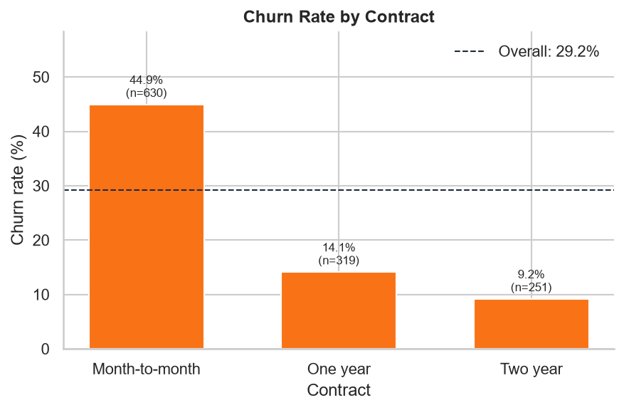
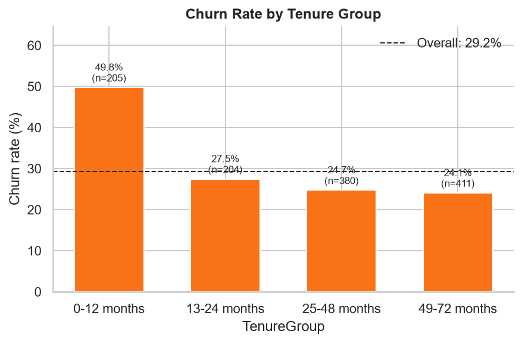
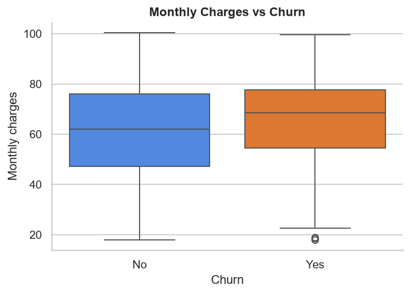
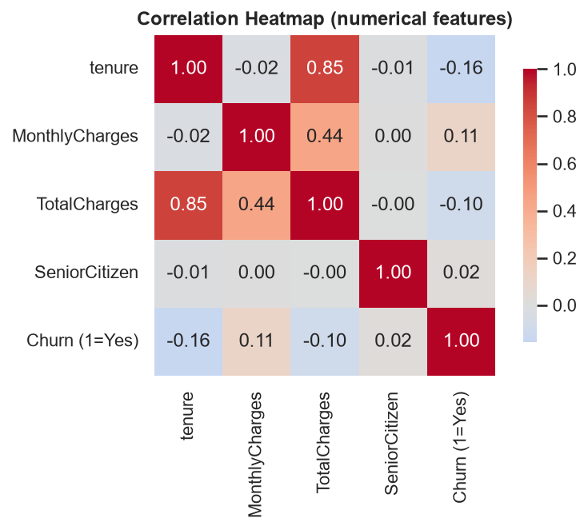
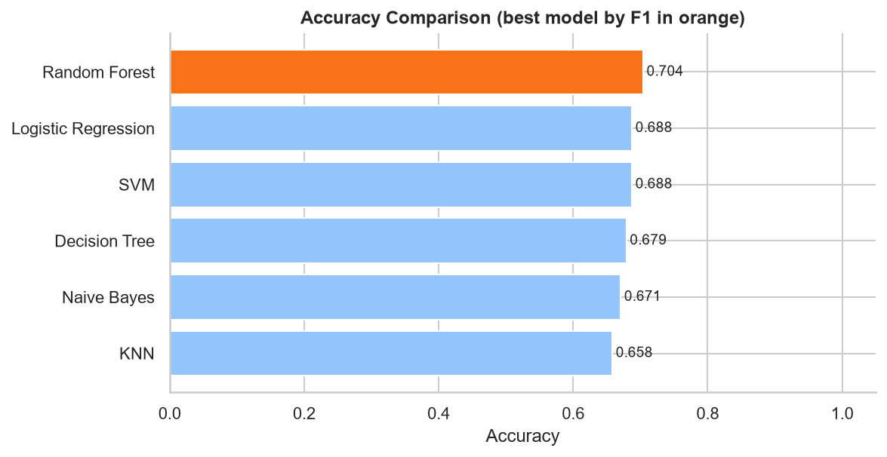
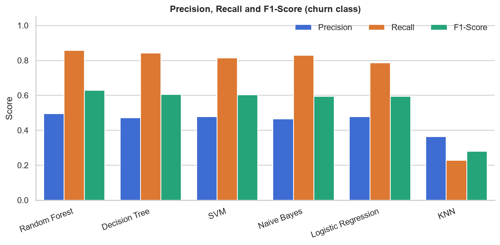
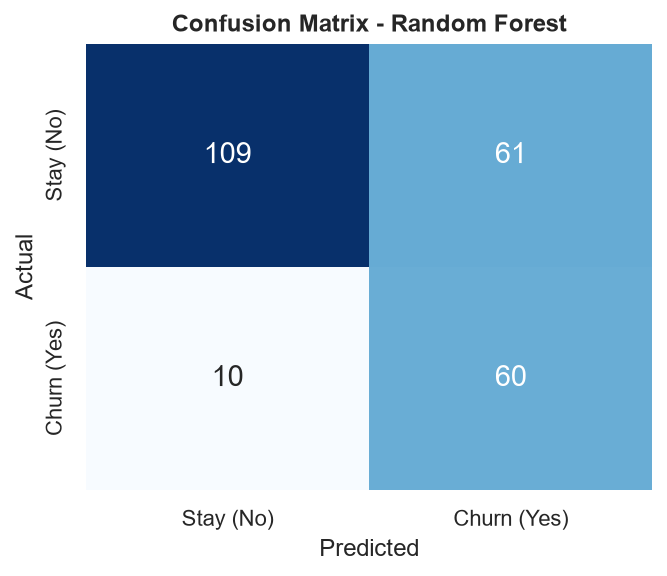
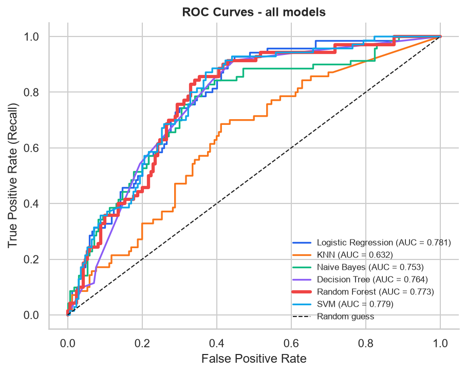
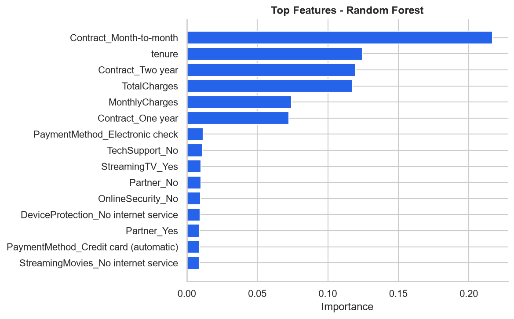

**Student name:** ____________________  **Roll no.:** ____________________
**Semester / Section:** ____________  **Guide:** ____________________  **Date:** ____________

# 1. Title

Customer Churn Prediction & Retention Analytics Using Machine Learning (Telecom Case Study)

# 2. Abstract

Customer churn, the loss of customers to competitors, is one of the biggest revenue problems in the telecom industry,
because keeping a customer is cheaper than winning a new one. This project builds a Customer Churn Prediction and
Retention Analytics System on the supplied synthetic dataset `telco_customer_churn_synthetic.csv` (1,200 customers: `customerID`,
19 input features and the target `Churn`). The data was inspected and cleaned, `customerID` was excluded, categorical features were
one-hot encoded, numerical features were scaled, and a stratified 80/20 split was used. Six classifiers (Logistic Regression,
KNN, Naive Bayes, Decision Tree, Random Forest and SVM) were tuned with 5-fold cross-validation on the training data
and evaluated on 240 unseen customers using accuracy, precision, recall, F1-score and ROC-AUC. Random Forest gave the best
F1-score (0.628) with recall 0.857, precision 0.496, ROC-AUC 0.773 and accuracy 0.704. A Streamlit dashboard presents KPIs,
exploratory analysis, model comparison, single-customer prediction with a risk category, and rule-based retention advice.
The dataset is synthetic and educational, so the results demonstrate the method and are not claims about a real company.

# 3. Introduction

Telecom companies sell phone and internet services on monthly billing. Customers can leave easily, so companies try to
identify customers who are likely to leave and offer them a reason to stay. Machine Learning can learn patterns from past
customers (contract type, tenure, charges, services used) and estimate the churn risk of present customers.
Churn prediction is a **supervised binary classification** problem: the input is customer information and the output is
Churn = Yes or No.

# 4. Industry Problem Statement

A telecom operator loses revenue each time a customer leaves. Marketing teams have a limited retention budget, so they cannot
call or give offers to everyone. They need to know (a) which customers are at risk, (b) what behaviour is linked to leaving, and
(c) what action to take. The problem solved here is: *given a customer's profile, predict whether they will churn,
estimate the probability, and suggest suitable retention actions.*

# 5. Objectives

1. Analyse the telecom customer dataset and understand what is associated with churn.
2. Build a leak-free preprocessing and modelling pipeline using Scikit-learn.
3. Train and compare six classification algorithms on the same train/test split.
4. Evaluate models with accuracy, precision, recall, F1-score and ROC-AUC and select the best model sensibly.
5. Build an interactive Streamlit dashboard with prediction and risk categories.
6. Provide rule-based retention recommendations, clearly separated from ML predictions.

# 6. Scope of the Project

**In scope:** the supplied CSV file, binary churn classification, model comparison, dashboard, retention rules, documentation.
**Out of scope:** real-time data feeds, deep learning, customer-lifetime-value optimisation, deployment to a cloud server,
causal analysis (the project finds associations, not causes).

# 7. Dataset Description

| Item | Value |
|---|---|
| File | telco_customer_churn_synthetic.csv (synthetic, educational) |
| Rows x columns | 1,200 x 21 |
| Missing values | 0 |
| Duplicate rows / duplicate customer IDs | 0 / 0 |
| Class distribution | Churn = No: 849 (70.75%), Churn = Yes: 351 (29.25%) |
| Target variable | Churn (Yes -> 1, No -> 0) |
| Identifier (not used as feature) | customerID |

**Feature groups**

| Group | Columns |
|---|---|
| Demographics | gender, SeniorCitizen (0/1), Partner, Dependents |
| Account | tenure (months), Contract, PaperlessBilling, PaymentMethod |
| Phone and internet services | PhoneService, MultipleLines, InternetService (DSL / Fiber optic / No) |
| Add-on services | OnlineSecurity, OnlineBackup, DeviceProtection, TechSupport, StreamingTV, StreamingMovies |
| Charges | MonthlyCharges (18.00 - 100.37), TotalCharges (0 - 6,885.86) |

The class imbalance (about 29% churners) is the reason accuracy alone is a poor choice for model selection.

# 8. Software and Hardware Requirements

**Hardware (minimum):** any laptop with 4 GB RAM (8 GB recommended), dual-core CPU, 1 GB free disk space. No GPU is needed.
**Software:** Windows 10/11, Python 3.11 or 3.12, VS Code, a modern web browser (Chrome / Edge).
**Python libraries:** pandas, NumPy, Matplotlib, Seaborn, Scikit-learn, joblib, Streamlit.

# 9. Technologies Used

| Technology | Use in the project |
|---|---|
| Python | Programming language |
| Pandas, NumPy | Data loading, cleaning, tables, numerical work |
| Matplotlib, Seaborn | All exploratory and evaluation charts |
| Scikit-learn | Pipeline, ColumnTransformer, models, GridSearchCV, metrics |
| joblib | Saving and loading trained models |
| Streamlit | Interactive web dashboard |

# 10. Methodology

1. Load the CSV and inspect shape, data types, missing values, duplicates and class balance.
2. Clean the data (strip spaces, numeric `TotalCharges`, remove duplicates if any).
3. Remove `customerID`; define `Churn` as the target.
4. Split into 80% training (960 rows) and 20% test (240 rows) using a stratified split with `random_state = 42`.
5. Build a Pipeline: imputer -> scaler / one-hot encoder -> classifier.
6. Tune each model with `GridSearchCV` (5-fold stratified CV, F1 scoring) on the training set only.
7. Evaluate every tuned model on the test set; compute the five metrics; select the best model by F1-score (ROC-AUC tie-break).
8. Save the models and results; present them in the Streamlit dashboard.

# 11. System Architecture

```
telco_customer_churn_synthetic.csv
          |
          v
 preprocessing.py  (load, inspect, clean, split)
          |
          v
 Pipeline = ColumnTransformer (scale + one-hot)  ->  Classifier
          |
          v
 model_training.py (GridSearchCV, 6 models) --> evaluation.py (metrics, best model)
          |
          v
 models/*.joblib  +  outputs/reports  +  outputs/graphs
          |
          v
 app.py (Streamlit)  <--  prediction.py (validate input, predict, risk, rules)
```

# 12. Data Preprocessing

| Step | What was done | Why |
|---|---|---|
| Inspection | Shape, dtypes, missing, duplicates, class counts | Know the data before modelling |
| Missing values | None found; the pipeline still contains median / most-frequent imputers | Makes the app robust to blanks in future data |
| Duplicates | None found; the code removes them if present | Avoid double counting |
| customerID | Dropped from features | A unique label has no predictive meaning and would cause overfitting |
| Encoding | OneHotEncoder for 15 categorical columns (45 model inputs in total) | Models need numbers; one-hot avoids a false order |
| Scaling | StandardScaler on tenure, MonthlyCharges, TotalCharges | Needed by KNN, SVM and Logistic Regression |
| Split | Stratified 80/20, random_state = 42 | Same churn share in train (29.27%) and test (29.17%) |
| Leakage prevention | Preprocessing inside the Pipeline, fitted on training data only | The test set stays truly unseen |

# 13. Explanation of Algorithms Used

**Logistic Regression.** A linear model that estimates the probability of churn with the sigmoid function. Simple, fast and
easy to explain. Tuned parameter: C = 0.1 (regularisation strength).

**K-Nearest Neighbors (KNN).** Classifies a customer by the majority class among the k most similar customers (distance in
scaled feature space). It has no training phase but is sensitive to scaling and to many one-hot columns. Chosen: k = 5, distance-weighted.

**Naive Bayes (Gaussian).** Uses Bayes' theorem and assumes features are independent given the class. Very fast, but the
independence and Gaussian assumptions are not fully true for one-hot data, and its probabilities can be over-confident.

**Decision Tree.** Learns if-then splits (for example Contract = Month-to-month?). Easy to interpret but can overfit if too deep.
Chosen: max_depth = 3, min_samples_leaf = 10.

**Random Forest.** Many decision trees trained on random samples of rows and features; the votes are averaged. Reduces overfitting
and handles non-linear patterns. Chosen: 200 trees, max_depth = 5, min_samples_leaf = 3.

**Support Vector Machine (RBF kernel).** Finds the boundary with the largest margin between classes, using a kernel to handle
non-linear patterns. Needs scaled data. Chosen: C = 10, gamma = 0.01, probability estimates enabled.

`class_weight="balanced"` was used for Logistic Regression, Decision Tree, Random Forest and SVM so that the minority churn class gets more weight.
KNN and Naive Bayes do not support this option.

# 14. Exploratory Data Analysis

All charts are generated by `train_models.py` and stored in `outputs/graphs/`. Key findings from the actual data:

- **Churn rate overall:** 29.25% (351 of 1,200 customers).
- **Contract type:** month-to-month 44.9%, one-year 14.1%, two-year 9.2%. This is the strongest pattern.
- **Tenure:** customers with 0-12 months tenure churn at about 50%, versus about 24-27% for longer tenures. Tenure has a correlation of -0.156 with churn.
- **Monthly charges:** churn rises from 18.8% (charges up to 40) to 32-35% (charges above 60). Correlation with churn is +0.113.
- **Internet service:** no internet 18.1%, DSL 30.3%, Fiber optic 33.0%.
- **Payment method:** electronic check 33.6%, bank transfer 29.2%, credit card 26.6%, mailed check 23.6%.
- **Gender:** female 28.4%, male 30.0% - a very small difference, so gender is not an important driver here.
- **Tech support / online security:** customers with internet but without these services churn at 34.8%.

{width=80%}

{width=80%}

{width=70%}

{width=70%}

# 15. Implementation Details

| File | Responsibility |
|---|---|
| `src/preprocessing.py` | Load, inspect, clean, ColumnTransformer, stratified split |
| `src/model_training.py` | Six model pipelines, parameter grids, GridSearchCV, save/load |
| `src/evaluation.py` | Metrics, best-model rule, accuracy / PRF / confusion matrix / ROC / feature-importance charts |
| `src/eda.py` | Exploratory charts (used by both the training script and the dashboard) |
| `src/prediction.py` | Input validation, prediction, risk category, rule-based recommendations |
| `train_models.py` | Runs the whole training workflow and saves outputs |
| `app.py` | Streamlit dashboard with six pages |

**Dashboard pages:** Dashboard (KPI cards and charts), Dataset Explorer (search, filters, missing values, data types, statistics,
CSV download), Churn Analysis (filtered group analysis), Model Comparison, Predict Churn (form, label, probability, risk level, recommendations)
and Retention Recommendations (rules checked against the data).

**Risk category:** Low if probability < 30%, Medium for 30% to under 60%, High for 60% or more. The probability is shown as an estimate, never as a guarantee.

**Rule-based recommendations** (separate from ML): month-to-month contract -> discounted long-term contract; high monthly charges (>= 80) -> lower-cost plan;
no tech support -> tech-support offer; no online security -> security trial; tenure under 12 months -> onboarding and loyalty rewards;
electronic check -> automatic payment incentive; fibre with high charges -> service/price review.

# 16. Results and Comparison

Results on the 240-customer test set (churn = positive class):

| Model | Accuracy | Precision | Recall | F1-score | ROC-AUC |
|---|---|---|---|---|---|
| **Random Forest** | 0.704 | 0.496 | 0.857 | 0.628 | 0.773 |
| Decision Tree | 0.679 | 0.472 | 0.843 | 0.605 | 0.764 |
| SVM | 0.688 | 0.479 | 0.814 | 0.603 | 0.779 |
| Naive Bayes | 0.671 | 0.464 | 0.829 | 0.595 | 0.753 |
| Logistic Regression | 0.688 | 0.478 | 0.786 | 0.595 | 0.781 |
| KNN | 0.658 | 0.364 | 0.229 | 0.281 | 0.632 |

**Why recall, precision and F1 matter.** Only 29% of customers churn, so a model that always predicts "No" would score about 71% accuracy
while finding no churners. *Recall* tells how many real churners we catch (missing them loses revenue). *Precision* tells how many flagged customers
really leave (low precision wastes retention budget). *F1* balances both, so it was used to choose the best model, with ROC-AUC as tie-breaker.

**Best model: Random Forest.** Confusion matrix (rows = actual, columns = predicted):

| | Predicted Stay | Predicted Churn |
|---|---|---|
| Actual Stay (170) | 109 | 61 |
| Actual Churn (70) | 10 | 60 |

It identifies 60 of 70 churners (recall 0.857) but also flags 61 customers who stayed (precision 0.496). For a retention campaign where an offer is cheap
compared with losing a customer, this trade-off can be acceptable; if offers are costly, the decision threshold or model should be revisited.

**Honest observations.** (1) Logistic Regression has the highest ROC-AUC (0.781), and the top five models are close; with only 240 test customers a gap
of 0.02-0.03 may be chance. (2) KNN performs clearly worst. (3) Random Forest's most important features are Contract = Month-to-month (0.217), tenure (0.125),
Contract = Two year (0.120), TotalCharges (0.118), MonthlyCharges (0.074) and Contract = One year (0.073), which agrees with the EDA.

{width=75%}

{width=80%}

{width=55%}

{width=65%}

{width=75%}

# 17. Screenshots (placeholders)

Run the app, take screenshots and paste them below (also save copies in the `screenshots/` folder).

| No. | Screenshot | Paste here |
|---|---|---|
| 1 | Dashboard page with KPI cards | [ Screenshot 1 ] |
| 2 | Dataset Explorer page | [ Screenshot 2 ] |
| 3 | Customer Churn Analysis page | [ Screenshot 3 ] |
| 4 | Model Comparison page | [ Screenshot 4 ] |
| 5 | Predict Churn - form and result | [ Screenshot 5 ] |
| 6 | Retention Recommendations page | [ Screenshot 6 ] |

# 18. Advantages

- Uses the real supplied dataset and reports only measured results.
- Leak-free pipeline: preprocessing is fitted on training data only and reused unchanged for new customers.
- Fair comparison: six models on one identical split, tuned the same way.
- Model choice based on F1/recall/ROC-AUC rather than accuracy alone.
- Easy-to-use dashboard with input validation and a clear separation between ML output and business rules.

# 19. Limitations

- The dataset is synthetic and small (1,200 rows); real-world patterns and accuracy may differ.
- The test set has only 240 customers, so metrics are uncertain, and model differences are small.
- Precision is about 0.50: roughly half of the flagged customers would not have left.
- The default threshold of 0.5 was used; a business-specific threshold was not optimised.
- Probabilities are estimates, and some models (e.g. Naive Bayes) are over-confident.
- Associations are not causes: giving a discount does not automatically prevent churn.
- Rules for high charges and for fibre with high charges are only weakly linked to churn in this dataset.
- The model is not retrained automatically when new data arrives.

# 20. Future Scope

- Test on real or larger telecom data and add a time dimension (customer history).
- Tune the decision threshold using the cost of an offer versus the value of a retained customer.
- Try gradient boosting (XGBoost / LightGBM) and probability calibration.
- Handle imbalance with SMOTE or cost-sensitive learning and compare.
- Use SHAP for explanations of individual predictions.
- Measure retention campaigns with A/B tests; deploy the app on the cloud with a database and scheduled retraining.

# 21. Conclusion

The project built a complete, working churn prediction and retention analytics system. Contract type, tenure and charges are the main factors
associated with churn in this synthetic dataset. After tuning six classifiers on the same stratified split, Random Forest achieved the best F1-score
(0.628) and a recall of 0.857 on unseen data, at the cost of lower precision (0.496). The Streamlit dashboard allows exploration of the data,
comparison of models, prediction for a new customer with a risk category, and rule-based retention suggestions. The limitations of the synthetic dataset
and the small test set are stated clearly, and the results should be read as a demonstration of the method.

# 22. References

1. Pedregosa, F. et al. (2011). Scikit-learn: Machine Learning in Python. *Journal of Machine Learning Research*, 12, 2825-2830.
2. Scikit-learn documentation: https://scikit-learn.org/stable/
3. Streamlit documentation: https://docs.streamlit.io/
4. Pandas documentation: https://pandas.pydata.org/docs/
5. Matplotlib documentation: https://matplotlib.org/stable/ and Seaborn documentation: https://seaborn.pydata.org/
6. Breiman, L. (2001). Random Forests. *Machine Learning*, 45(1), 5-32.
7. Hastie, T., Tibshirani, R., Friedman, J. (2009). *The Elements of Statistical Learning*. Springer.
8. Fawcett, T. (2006). An introduction to ROC analysis. *Pattern Recognition Letters*, 27(8), 861-874.
